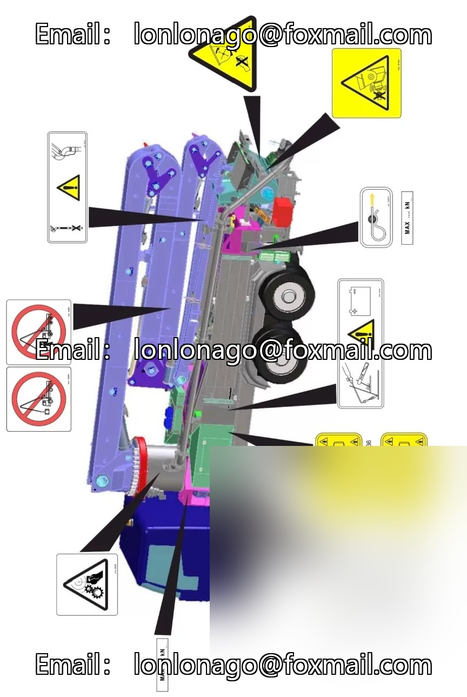
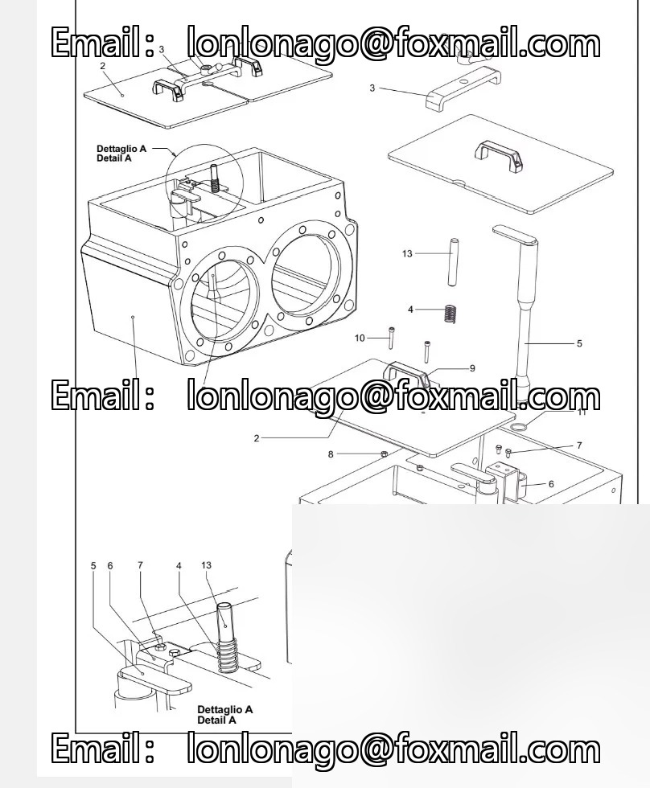
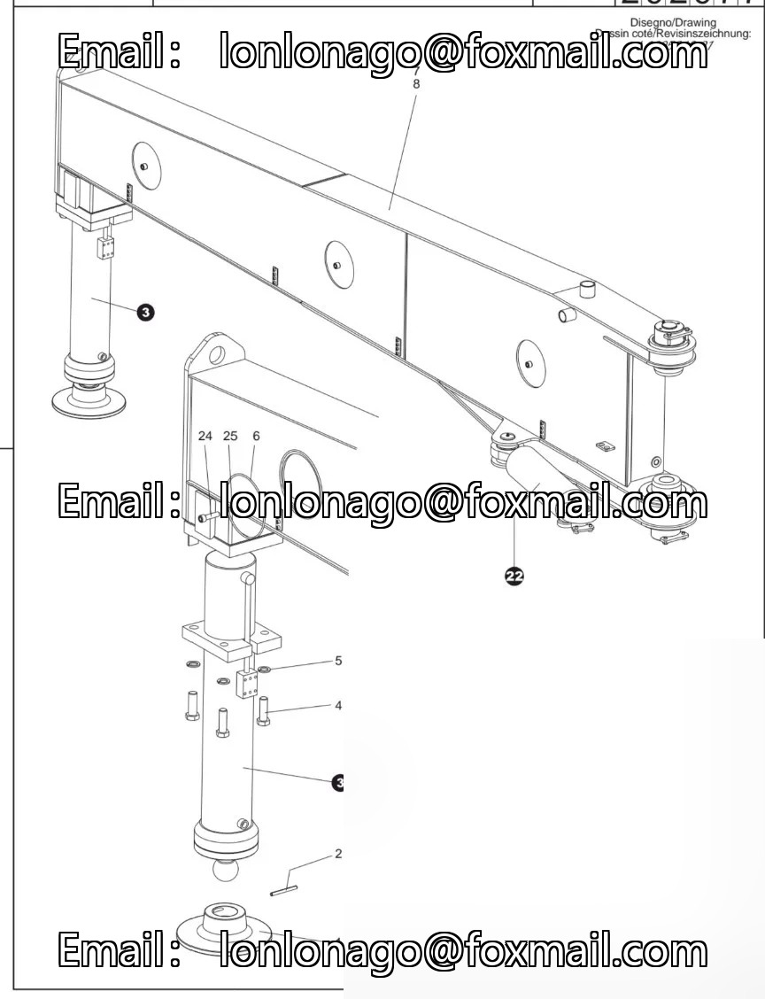
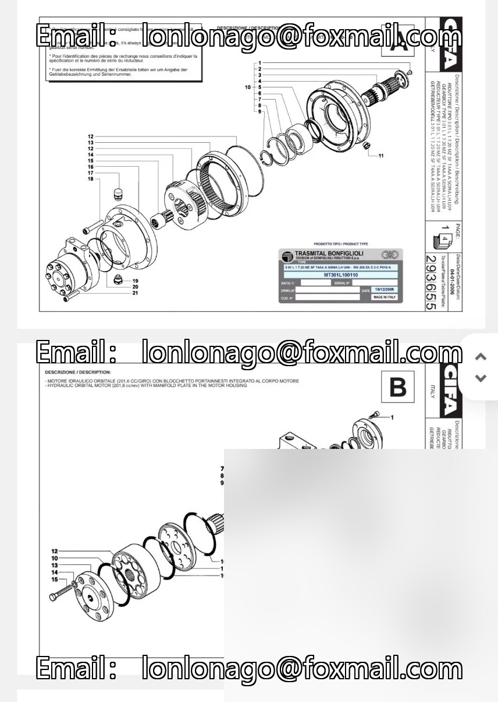

# CIFA (Italian concrete machinery brand, currently under Zhonglian Heavy Industry) vehicle-type concrete arm

## Body

CIFA (Italian concrete machinery brand, now part of Zoomlion) vehicle-based concrete arm frame pump truck technical materials
PDF , 380 pages
Includes detailed parameters such as device main model HPG 1808-1113 IF9, chassis/arm frame model K41-XRZ, etc.
Suitable for professional uses such as maintenance, spare parts procurement, and system maintenance.
comprehensive content, direct upload to file sharing link.
881832556

The technical materials cover the CIFA onboard concrete arm pump technology, a PDF of 380 pages, including detailed parameters for main models, chassis and arm model, and professional uses such as maintenance, spare parts procurement and system maintenance.

<!-- AI_ENRICHED -->

## Images

## Payment

Here is a pay link on Stripe ( https://buy.stripe.com/3cs8yP7sY87d0vu9AB ). Please contact me lonlonago@foxmail.com after funding $89, and I will send you a complete data files , thank you!

